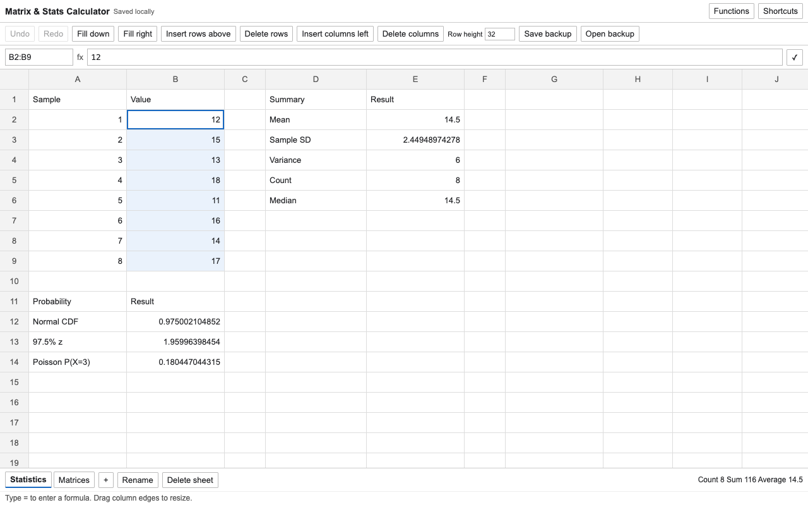
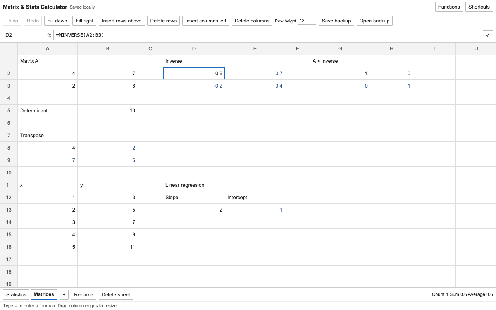
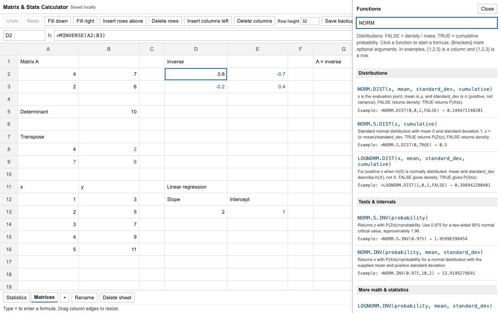

# Matrix & Stats Calculator

A lightweight Chrome extension that puts a spreadsheet calculator in your sidebar. Built primarily to help with **MAS-I exam preparation**, it brings together the math, probability, statistics, matrix and regression functions useful for working through study problems. It's also useful for everyday calculations.

Click the extension button or press **Alt+Shift+S** to open the docked sidebar beside your current page. Drag Chrome's panel divider to adjust its width. Requires Chrome 116 or newer.

**[Install from the Chrome Web Store](https://chromewebstore.google.com/detail/matrix-stats-calculator/abmnojdcmmobidllghhcgkfcgehfdccf)**

## Contributing and feedback

Found a bug, missing a function, or have an idea for a useful feature? Feel free to [open an issue](https://github.com/akluu/matrix-stats-calculator/issues). Feedback from MAS-I study sessions and other calculation tasks is welcome.

For calculation bugs, include the formula, a small example of the inputs, and the expected versus actual result. For feature or function requests, describe the problem you're trying to solve.

Want to add a feature or function yourself? Fork the repository, make your changes, and open a pull request. See [Develop and verify](#develop-and-verify) for local setup and tests.

## Screenshots

Statistics and probability calculations, with selection totals:



Matrix operations and linear regression:



Searchable function help with parameter explanations and worked examples:



Screenshots use sample data and a wide calculator view for readability. The extension opens in Chrome's docked sidebar, which you can resize.

## Saving your work

If two browser windows have the sidebar open, saving in one pauses the other. The paused view offers **Save this view as backup** and **Reload latest** so an unfinished draft cannot silently overwrite newer work. **Save cell draft as text** also preserves unfinished input independently, including input that exceeds cell limits.

No account, server, page access, or remote scripts. Work is automatically saved in the extension's local browser storage. **Save backup** exports a JSON workbook; **Open backup** restores it. Keep a backup before removing the extension or clearing browser storage. Excel `.xlsx` import is not included; paste tabular data directly from Excel or Sheets.

## Calculations

Supports all 60 distinct functions in the requested function list (see [function coverage](FUNCTIONS.md)), plus the calculation engine's basic arithmetic, logarithms, trigonometry, rounding, conditional sums, logic and lookups. The **Functions** panel includes usage notes and tested worked examples for 106 functions. Square brackets mark optional arguments; braces in examples describe inline arrays. Formula-name completion appears while typing; Tab inserts a suggestion.

- Comma-grouped numeric inputs such as `1,234.5` are recognized on entry and paste. Prefix an apostrophe to keep them as text.
- Legacy `BETADIST(x, alpha, beta, [A], [B])` is cumulative-only, matching Excel.
- Distributions accept `FALSE` for density/mass and `TRUE` for cumulative probability.
- `MMULT`, `MINVERSE`, `TRANSPOSE` and `LINEST` spill results into neighboring empty cells. Edit the top-left formula to change an array.
- `LINEST(y, x, TRUE, TRUE)` returns five rows: coefficients; coefficient standard errors; R² and residual standard error; F and residual degrees of freedom; regression and residual sums of squares. Multiple-regression slopes are in reverse predictor-column order, followed by the intercept.
- `T.INV.RT(p, df)` is an additional right-tail helper, equivalent to `-T.INV(p, df)` for interior probabilities.
- Inputs and results keep full calculation precision. The grid displays up to 12 significant digits; selecting a normal cell shows its original input in the formula bar.

### Compatibility limits

Excel compatibility has the following limits. `LINEST` requires a literal `TRUE`, `FALSE`, `1` or `0` for its statistics flag because that determines the result's dimensions. Redundant predictors return `#NUM!` instead of Excel's reduced-rank fit; remove the redundant columns. Singular or numerically rank-deficient matrix inversions return `#NUM!`. Some engine functions and extreme distribution tails can differ from Excel.

## Selection and editing

Use **Insert rows above**, **Delete rows**, **Insert columns left**, or **Delete columns** to act on the selected rows or columns. The status message confirms the action, and Undo reverses it.

- Drag or Shift-click to select a range; Ctrl/Cmd-click adds another range. Row and column headers select their full row/column.
- Arrows, Enter and Tab navigate; Shift reverses Enter/Tab and extends arrow selections. Ctrl/Cmd+arrows jump through data regions.
- Ctrl+Space selects a column; Shift+Space selects a row; Ctrl/Cmd+A selects the grid.
- Copy/cut/paste works with tab-separated data. Internal copies adjust relative references. Copy one contiguous range at a time. To copy a live array formula, select only its top-left cell; selecting an array result range copies its values, with an explicit message. Undo/redo and structural edits invalidate the internal clipboard; copy again afterward.
- **Fill down/right** or Ctrl/Cmd+D/R copies the first row/column through the selection, adjusting references.
- While editing a formula, the hint bar highlights the current function argument, including nested calls. Colored reference labels match the referenced cells and ranges on the current sheet. Hints follow the caret and F4 changes; highlighting only touches visible cells.
- F2 or double-click edits. Escape cancels. F4 cycles relative/absolute cell references. Click or drag cells while editing a formula to insert references.
- Undo/redo covers workbook edits. Undo history is session-only.
- The bottom bar shows count, numeric sum and numeric average for the selection.
- Drag a column header's right edge to resize it. **Row height** adjusts all rows for visibility.

## Performance and architecture

The grid has 2,000 rows × 104 columns per sheet and allows 30 sheets, with a workbook-wide limit of 100,000 input cells and 1,000,000 text/formula characters. Only visible cells plus a small buffer are rendered. One HyperFormula instance owns formulas, dependency recalculation and references. Undo history keeps bounded patches of changed inputs, preserving array formulas without storing complete workbook copies. Scrolling reads cached values; it does not recalculate formulas. Committed edits still scan workbook inputs for atomic undo and serialize a full JSON autosave, so commit time grows with workbook size; this is not an unlimited-size spreadsheet. Matrix routines use `ml-matrix`; custom distribution handling uses `jstat`. The background service worker is event-driven.

The `src` folder contains the extension implementation, `public` contains the extension shell, and `tests` contains the calculation and browser tests.

## Develop and verify

From the repository root:

```sh
npm ci --ignore-scripts
npm run build
npm test
npx playwright install chromium
npm run test:ui
```

To try your changes locally:

1. Open `chrome://extensions` in Chrome.
2. Enable **Developer mode**.
3. Choose **Load unpacked** and select this project's `dist` folder (the folder containing `manifest.json`).
4. Pin **Matrix & Stats Calculator** in Chrome's extensions menu.

Updating an existing installation: close the old calculator view, click **Reload** on the existing extension card, then click its toolbar icon. Reloading the same installed extension preserves its saved workbook. The shortcut triggers the same toolbar action; Chrome lets you customize it at `chrome://extensions/shortcuts`.

The Playwright tests use a separate temporary Chrome profile and do not touch your normal browser profile.

The numerical tests cover each requested function, matrix and regression outputs, errors, and percentage inputs. Model/browser tests cover references, spills, copying, fill, undo, structural changes, persistence, selection, sizing, and virtualized scrolling. Browser performance measurements are local benchmarks, not guarantees for every machine or workbook.

## License

The extension code is GPL-3.0-only; see `LICENSE`. HyperFormula is used under its GPLv3 option. Dependency notices are included in the built extension's `licenses` directory. Source code and the lockfile are included here for reproducible builds.
